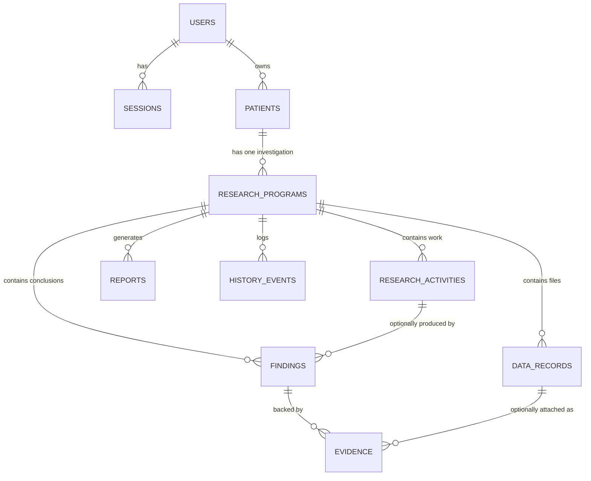
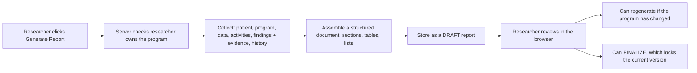

# Omanta Lab — How the prototype works (plain-English)

This document explains Omanta to anyone: a doctor, a researcher, an investor, or a
developer who just joined. No jargon is required to read the first few sections; the
technical details are kept at the end for people who want them.

If you want the fastest possible picture: read **Part 1**, **Part 2**, and **Part 3**.
Everything else is depth.

---

## Part 1 — What Omanta is, in one paragraph

The long-term product direction is a shared case workspace for Omanta's research team and
patients, intended to be hosted at `lab.omanta.com`. That direction is engineer-stated and not
yet validated with the founder, researchers, or patients. The implementation described here is
still a single-researcher synthetic-data prototype and is not ready for patient accounts or real
patient data.

Omanta is a workspace where a **researcher keeps track of the scientific work being
done on one patient's case**. It is not a medical record and it is not a lab system.
It is the "lab notebook plus project folder" for a research investigation.

Every patient in Phase 0 is **synthetic and de-identified** — fake names, fake data,
fake results. Nothing here may be used to make a clinical decision.

The whole app is about one spine:

> A researcher signs in → opens a patient → sees the research program for that patient
> → reviews the data files → records the work being done (activities) → writes down
> what the work found (findings) → attaches supporting sources (evidence) → generates
> a written research report.

That spine is the product. Everything in the system exists to support it.

---

## Part 2 — The data model (what we store)

Think of the app as a stack of folders. Each folder holds the items below it.

```
Researcher  (a person who signs in — "you")
  └── Patient  (one person whose case is being studied — "the subject")
        └── Research Program  (the ongoing investigation of that patient's case)
              ├── Data      — files uploaded: WES variants, karyotype, treatment history, etc.
              ├── Activities — pieces of work: variant review, imaging review, cohort comparison…
              ├── Findings   — things the researcher concluded from the work
              ├── Evidence   — sources backing a finding: a paper, a database, a URL, a DOI
              ├── Reports    — the written research report, assembled automatically
              └── History    — a log of every event: "data uploaded", "finding recorded", …
```

Key rules:

- **One researcher → many patients.** A researcher owns their patients.
- **One patient → exactly one research program.** The program is the patient's case.
- Everything below a patient belongs to that patient and is **cascading**: delete the
  patient's program and its data, activities, findings, reports, and history go with it.
- **Evidence hangs off a finding**, and findings optionally name which activity they
  came from. Deleting an activity keeps the finding (it just loses the link).
- A researcher can only see their own patients. The app checks this on every request,
  on every page, and on every file download — not just at the menu level.

### The tables, in plain words

| Table                 | Plain meaning                           | Belongs to                        |
| --------------------- | --------------------------------------- | --------------------------------- |
| `users`               | The researchers who can sign in         | —                                 |
| `sessions`            | A "signed in on this browser" ticket    | a user                            |
| `patients`            | The people being studied                | a user                            |
| `research_programs`   | The investigation into a patient's case | a patient                         |
| `data_records`        | Files uploaded to the program           | a program                         |
| `research_activities` | Pieces of research work                 | a program                         |
| `findings`            | Conclusions recorded by the researcher  | a program (optional: an activity) |
| `evidence`            | Sources attached to a finding           | a finding                         |
| `reports`             | Generated research reports              | a program                         |
| `history_events`      | Audit log of actions taken              | a program                         |

### Diagram (for people who read diagrams)

Each line says "one A has many B".

```
users ──< sessions
users ──< patients
patients ──< research_programs
research_programs ──< data_records
research_programs ──< research_activities
research_programs ──< findings
findings ──< evidence
research_activities ──< findings     (optional link; "which activity produced this finding")
data_records ──< evidence            (optional link; "this evidence is attached to this uploaded file")
research_programs ──< reports
research_programs ──< history_events
```

In diagram form (an ER diagram — the standard way to draw a database):



---

## Part 3 — How data flows (the life of an action)

### The story of one user action

Whenever you click "Save", "Upload", "Record", "Generate", etc., the same journey
happens. There are no shortcuts:

```
1. YOU (browser/forms)
        │  click a button in a form
        ▼
2. NEXT.JS SERVER ACTION   (a function in src/actions/, runs on the server)
        │  validates the input (all fields checked)
        │  looks up YOUR session from the cookie
        │  looks up the program and CONFIRMS YOU OWN IT
        ▼
3. DATA LAYER   (src/lib/db/repo.ts)
        │  typed queries built by Drizzle
        │  checks ownership again
        ▼
4. SQLITE DATABASE   (data/omanta.db, a single file on disk)
        │
        ▼
5. HISTORY is appended automatically
        │  ("Activity 'Variant review' started", "Finding recorded", ...)
        ▼
6. The page refreshes and shows the result
```

Two things worth noticing:

- **The ownership check happens in the server code, on every single action and page.**
  A user cannot reach another researcher's data even by guessing a web address.
- **Every meaningful action is written to the history log automatically.** This gives
  the program a story you can read backwards: what was done, when, and by whom.

### The report: an example of a real flow

Generating a report is the app's headline feature, so here is its full journey.



A report is always assembled from the program's **current state**. Regenerate at any
time: the new draft reflects everything in the program at that moment. Finalizing is
the only action that freezes the content permanently.

---

## Part 4 — Security, at the level a non-expert can verify

Phase 0 is a synthetic-data demo, but the security habits are real. These are the
checks that matter and where each one lives:

| Concern                       | What the app does                                                           | Concrete checks you can run yourself                 |
| ----------------------------- | --------------------------------------------------------------------------- | ---------------------------------------------------- |
| Signing in                    | Passwords are hashed (bcrypt12); the browser only gets a ticket (cookie)    | A stolen DB file does not expose plaintext passwords |
| Stolen cookie                 | The cookie is matched against the database on every request, and it expires | Delete the session row → the user is logged out      |
| Seeing someone else's patient | Ownership is checked on every page and every action, server-side            | Open someone else's patient URL → you get a 404      |
| Downloading files             | File downloads re-check ownership on the server                             | Request another program's file URL → 403/404         |
| Uploading files               | Type, size (≤25 MB), and filename extension are validated                   | Try `.exe` or a giant file → rejected                |
| Secrets                       | No real secrets are committed to the repo                                   | `.env` is git-ignored                                |
| Patient safety                | All data carries a "Synthetic — demo" badge and the UI repeats the warning  | Banner on every dashboard                            |

---

## Part 5 — Technical map (for developers)

### Stack

| Layer      | Choice                                                      | File(s)                                                                     |
| ---------- | ----------------------------------------------------------- | --------------------------------------------------------------------------- |
| Framework  | Next.js 15 (App Router), TypeScript                         | `src/app/`                                                                  |
| Styling    | Tailwind CSS v3                                             | `src/app/globals.css`, `tailwind.config.ts`                                 |
| Database   | SQLite via better-sqlite3 (single file)                     | `data/omanta.db`                                                            |
| Data layer | Drizzle ORM (schema + typed queries + migrations)           | `src/lib/db/`                                                               |
| Auth       | Hand-rolled: bcryptjs + DB session tokens + httpOnly cookie | `src/lib/auth/`                                                             |
| Uploads    | Local disk under `data/storage/`, random filenames          | `src/lib/files/`                                                            |
| Tests      | Vitest, real SQLite in memory                               | `src/actions/workflow.test.ts`, `src/actions/patient.test.ts`, `src/lib/**` |
| Gate       | Prettier + ESLint + tsc + Vitest + `next build`             | `AGENTS.md`, `package.json` (`npm run verify`)                              |

### Where the app explains itself

The written guide lives at `/help`, inside the app, so nobody has to leave it to find out what a tab is
for. Its content is a typed array in `src/lib/help-content.ts` and the page renders that data rather than
hand-written markup. That is what lets a test assert the anchors stay unique, every part of the workflow
stays covered, and the guide never starts describing a feature that has not shipped.

### What the tests actually cover

`src/actions/workflow.test.ts` is the one to read first. It drives a whole case — upload, activity,
finding, evidence, report, finalize, delete — through the real server actions against a real database and
real files on disk, and checks three things at once: the work persisted, the generated report contains it,
and a researcher without access is refused at every step. Only the request scope is stubbed.

Everything that touches the database is tested this way rather than against a mock, because a mock cannot
tell you the query is wrong.

### Directory layout

```
src/
  app/                    Next.js pages (App Router)
    login/                Sign-in page
    patients/[id]/...     The patient workspace (overview, data, activities, findings, evidence, reports, history)
    patients/new/         Create patient + program
    report/[id]/          Report viewer
    help/                 In-app written guide
    api/files/[id]/       Authorized file download endpoint
  actions/                Server actions: validate input, check ownership, call repo
  components/
    ui/                   Design-system primitives (button, card, badge, form, empty-state, avatar)
    layout/               AppShell: chrome, nav, Help, environment disclosure
    workspace/            Case-workflow components (forms, delete buttons)
    dashboard/            Program/patient list
    onboarding/           First-run tour (client component, localStorage-backed)
  lib/
    db/schema.ts          The data model (tables), in code
    db/repo.ts            All database reads/writes (the data layer)
    report/generate.ts    Assembles reports from program state
    server/auth.ts        requireUser() — ownership + session checks
    auth/                 Password hashing, session cookies
    files/                Upload validation, storage, and preview parsing
    browser/              Client-safe storage helpers (onboarding progress)
    seed/                 Synthetic dataset definition
  middleware.ts           Route protection
scripts/                  setup.ts (fresh DB) and seed.ts (demo data)
drizzle/                  Auto-generated migration SQL
data/                     SQLite file + uploaded files (git-ignored)
.planning/                Product constraints, roadmap, state, and per-phase decisions
docs/                     This document
AGENTS.md                 The working agreement, including the mandatory verify gate
```

### Loading, error, and not-found boundaries

Every route has a state for the three moments that are not "the page":

| File                       | Covers                                                                                                                                                       |
| -------------------------- | ------------------------------------------------------------------------------------------------------------------------------------------------------------ |
| `src/app/loading.tsx`      | Navigation in progress. A quiet skeleton with `role="status"`, so a slow page announces itself instead of going blank.                                       |
| `src/app/error.tsx`        | A failure inside a page. Explains it in plain language, offers a retry, and shows a support reference. The underlying error text is never shown to the user. |
| `src/app/global-error.tsx` | A failure in the root layout itself — in practice, a database that is missing or not migrated. Renders its own document, since it replaces the layout.       |
| `src/app/not-found.tsx`    | An unknown URL. Named and branded, with a way back to the program list.                                                                                      |

`src/app/route-boundaries.test.tsx` asserts the accessible loading semantics, that no internal
error text reaches the page, and that each state offers a way forward.

### The one place where raw SQL appears

Almost all queries go through Drizzle's type-safe builder. Handwritten SQL is confined to four
places, none of it built from user input:

- `queryEvidenceForFindingIds` in `src/lib/db/repo.ts` — fetches evidence for a list of finding
  IDs. It builds an `IN (...)` list by stripping quotes manually rather than using bound
  parameters; correct for today, worth replacing if it ever grows.
- One templated `update patients set condition_summary = ?` in `src/actions/patient.ts`.
- One authorization lookup in `src/app/api/files/[id]/route.ts` (it uses the raw driver handle
  because it must authorize before streaming bytes).
- `nextPatientPid` in `src/lib/db/repo.ts` — a `sql` fragment taking `max()` of the numeric part of
  the pid, so the next human-readable patient id is derived from the highest one in use rather than
  from the row count. A count would hand back a number already taken as soon as retention and
  deletion (Phase 8) removed rows.

New ad-hoc SQL does not go in pages or components. Add a repo function instead.

### Migration workflow

1. Edit `src/lib/db/schema.ts` (e.g. add a column).
2. Run `npm run db:generate` → writes a new SQL file under `drizzle/`.
3. Next app start runs any pending migrations automatically
   (`src/lib/db/index.ts`, `migrateDb`).

### The gate

Nothing in this repo is considered done until `npm run verify` passes clean. See `AGENTS.md`
for the full agreement; the short version is format → lint → types → tests → production build,
with a new test (and a negative authorization test) required for new behavior.

---

## Part 6 — Keeping this document honest

- This document was generated from the actual source code (schema in
  `src/lib/db/schema.ts`, data layer in `src/lib/db/repo.ts`).
- Tables, ownership rules, sizes (25 MB), and flows were verified against the code
  during the Phase 0 acceptance test, and the technical map was re-checked against the
  code in Phase 1 (interface polish).
- If the schema or the flow changes, this document should change too — it is the
  single place a non-engineer can go to understand the system without reading code.
- See also `README.md` (what it is, how to run it) and `AGENTS.md` (the rules and the
  `npm run verify` gate every change must pass).
